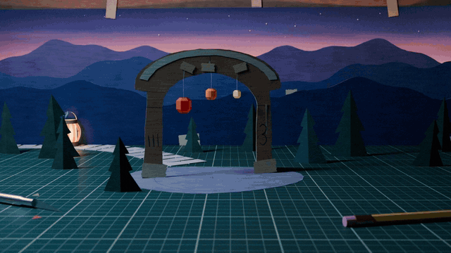
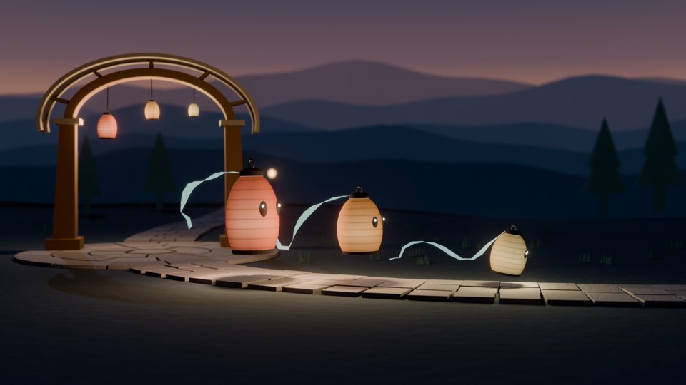
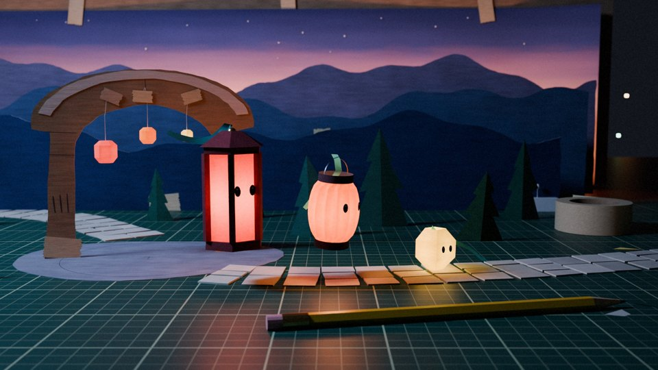
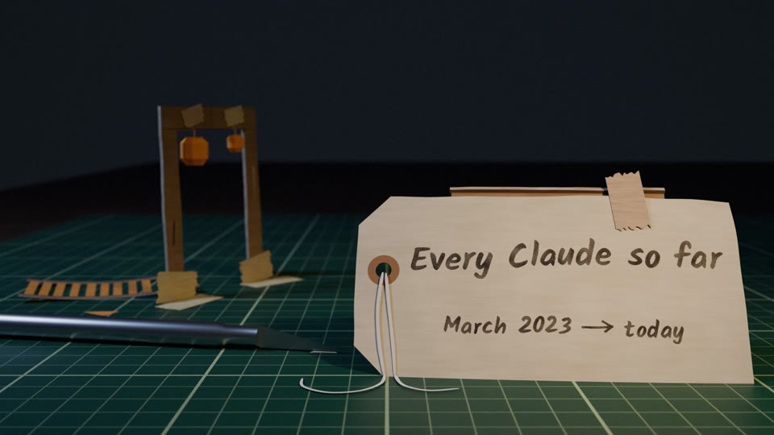
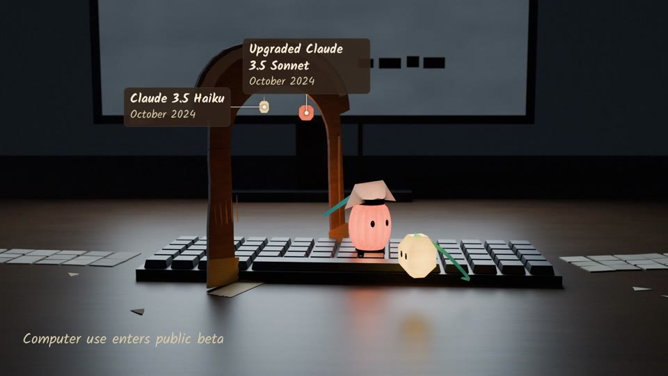
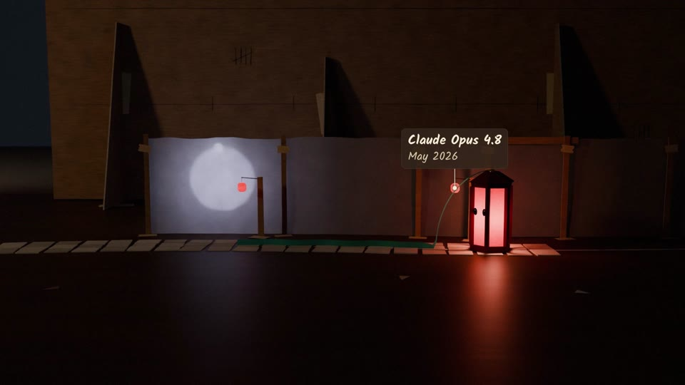
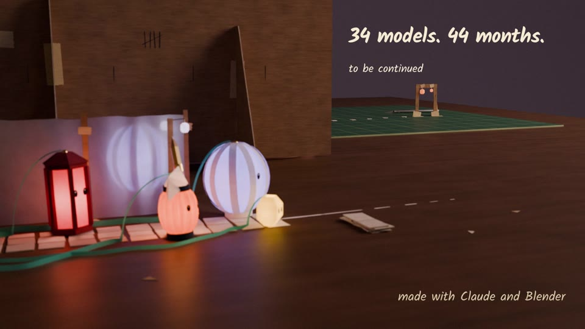
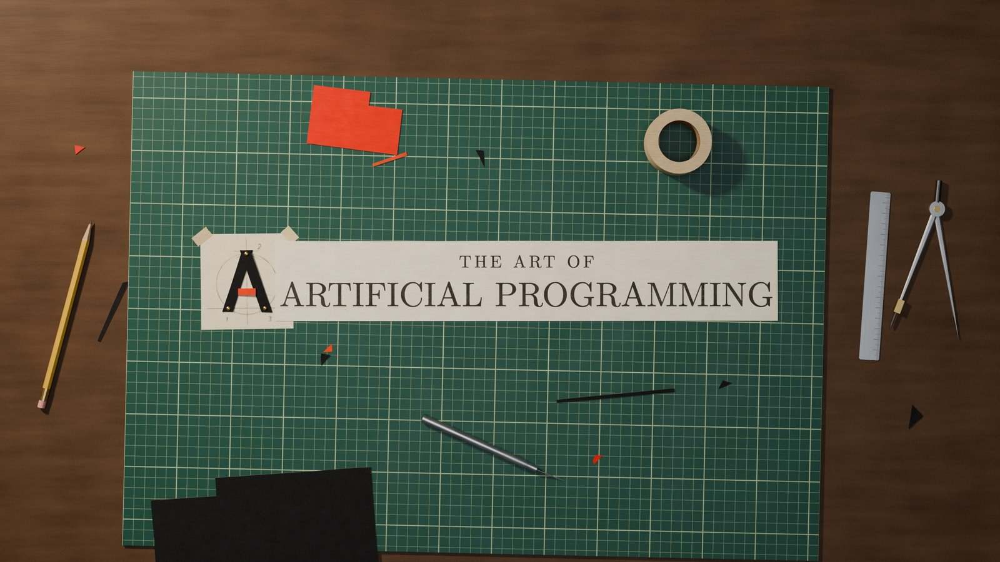
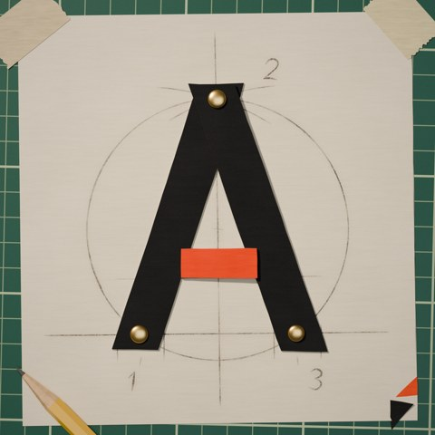

# Reelwright

<p align="center">
  
</p>

<p align="center">
  <em>Nine seconds of a 93-second film. Blender rendered every frame; Claude built the set,<br>
  moved the lanterns and placed the labels.</em>
</p>

Reelwright is a plugin for Claude that makes short films. You give it a subject. It checks the facts, proposes
several ways the film could look, builds one real shot for you to judge, and then animates, renders, assembles
and measures the rest.

It needs Blender and a Blender MCP server. There is nothing else to buy or connect.

## Install

```bash
claude plugin marketplace add Alexander-Tyagunov/reelwright
claude plugin install reelwright@reelwright
```

Open Blender, connect its MCP server to your Claude session, and ask:

> Make a film about our release history. Hand-made, about ninety seconds.

## One sample before the rest

<table>
  <tr>
    <td width="50%"></td>
    <td width="50%"></td>
  </tr>
  <tr>
    <td align="center"><em>The first sample</em></td>
    <td align="center"><em>The same shot, one sentence of feedback later</em></td>
  </tr>
</table>

Before it renders a film, the plugin renders one shot of it at final quality and stops. This is the only point
where it waits for you.

On this film the first sample was clean, correct and forgettable. The answer it got was: *"generic… doesn't feel
like a person made it."* The second sample has the same three characters at the same arch, built as paper on a
cutting mat, with tape, a pencil and cuts that are not quite straight. That one was approved, and the rest of the
film was built in its world.

A sentence like that should not die with the conversation. The plugin keeps a file, `studio/PROFILE.md`, that
records what you accepted and rejected, dated and in your own words, next to a ledger of every look already
used. Each new film starts by reading both, so it neither repeats the last film nor forgets what you said
about it.

## What happens when you ask for a film

1. **Facts.** Every name, number and date that will appear on screen is checked against its source first.
2. **Pitches.** Six or more ways the film could look, different in medium and not only in colour. One is chosen
   by fit with the subject, and the treatment says why. Your words override it.
3. **The sample.** One shot, final quality, with its labels and sound. You say yes, or what is wrong.
4. **A shot plan.** Every shot with its camera, its poses, the exact words of every label and every sound cue.
   It is validated before a frame is rendered: a label that cannot be read in the time it has fails here.
5. **Animation.** One animator agent per sequence, in Blender, each reading what the last one built and
   measured. Renders queue up on your machine, one at a time.
6. **Assembly.** The plan and the rendered frames become the film: tracked labels, generated sound, one MP4.
7. **A critic that did not make it** checks the facts again and looks for the marks of a generic render. Each
   finding is a small fix, a re-render of named frames, or left alone. One round.

<table>
  <tr>
    <td width="50%"></td>
    <td width="50%"></td>
  </tr>
  <tr>
    <td></td>
    <td></td>
  </tr>
</table>

## It measures, because it cannot watch

No agent has watched one of these films or heard its sound. They see still frames and numbers. A model that
looks at stills will happily approve a film that is frozen, unreadable or silent, so the plugin measures
instead: whether text stays still long enough to read, whether it sits on something too bright, whether a
frame went dark that should not have, how loud each cut is, whether the same input gives the same pixels twice.

Measuring caught real faults on the first film, among them twelve frames that rendered with a black desk for no
reason anyone found, and a whoosh at every cut that was the loudest sound in the film.

Every hand-over ends with a plain list of what nobody saw or heard. Press play once, with sound, before you
publish.

## What the first film cost

| | |
|---|---|
| Length | 93 seconds: an intro, 14 shots, an outro |
| Rendering | 1,078 frames at 1080p, about five hours on a laptop (Apple M1 Pro), 10 to 24 seconds a frame |
| Tokens | About 3 million, most of them on the animators |
| Outside services | None |

Stop-motion is shot at 12 frames a second, which is why a rendered film is affordable at all. The treatment
carries a budget for every film, and you can cap it.

## After the film

<table>
  <tr>
    <td width="62%"></td>
    <td width="38%"></td>
  </tr>
</table>

The publish skill prepares what a platform will ask for: title options, a description with chapters taken from
the film's own timeline, a thumbnail, every upload setting with a reasoned answer, and what a vertical version
would need. It can render channel art as stills in the film's look, as above. It prepares; you upload.

## The quick path

Not everything needs a film. For videos that recur, such as monthly release notes or quarterly numbers, the
plugin keeps a library of code-drawn scenes that turns one JSON file into a checked clip in minutes, at any
aspect ratio, with no Blender involved. The [plugin guide](plugin/README.md) covers both paths, every command
and every agent.

## Where it runs

| | One machine | Two machines |
|---|---|---|
| Claude and the assembly engine | Your computer | A cloud session |
| Blender and its renders | Your computer | Your computer, reached through Claude's desktop bridge |
| What you install | Blender, its MCP server, Node 24, ffmpeg, a Chromium browser | Blender and its MCP server |

The first film was made the second way: the laptop ran Blender and nothing else.

## What it has not proven yet

- One film and its channel art exist so far, and they share a family of look: paper on a desk. The rule that
  each film gets its own look is in the pipeline; more films will show how well it holds.
- There is no narration. Sound is a generated music bed and cues.
- Rendering takes hours, and the plugin cannot make Blender faster.
- It has been run with Blender 5.3 on macOS. Other setups should work and have not been tried.

## Inside

| Path | What it holds |
|---|---|
| [`plugin/`](plugin/) | The installable plugin: skills, agents, the TypeScript engine, the Blender library, references |
| [`plugin/skills/film/`](plugin/skills/film/) | The film pipeline, written as instructions a fresh session can follow |
| [`plugin/skills/video/blender/`](plugin/skills/video/blender/) | The Python library that runs inside Blender, and a small example project |
| [`tests/`](tests/) | Unit tests for the rules and end-to-end scenarios that run the real commands |
| [`docs/`](docs/) | [Architecture](docs/ARCHITECTURE.md), [testing](docs/TESTING.md), [known issues](docs/KNOWN-ISSUES.md) |

To work on it: Node 24 or newer, then `npm install` and `npm run check`. The engine is TypeScript that Node runs
directly, with no build step and no runtime dependencies. Conventions for people and agents are in
[`CLAUDE.md`](CLAUDE.md).

## Licence

MIT. Bundled fonts are under the SIL Open Font License 1.1.

Made by Alex Tyagunov.
