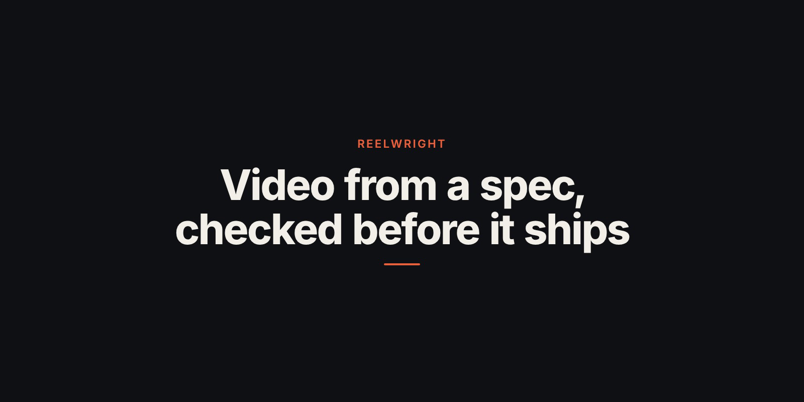
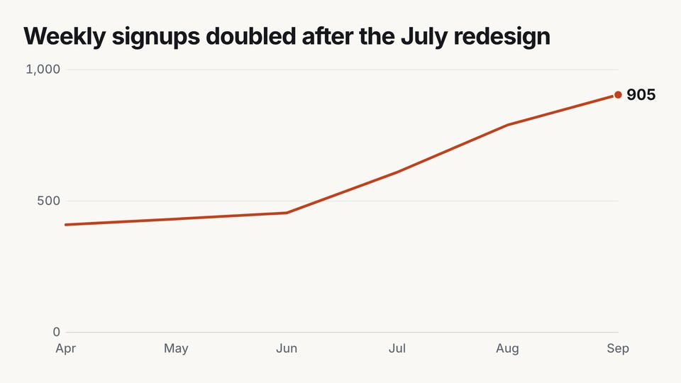
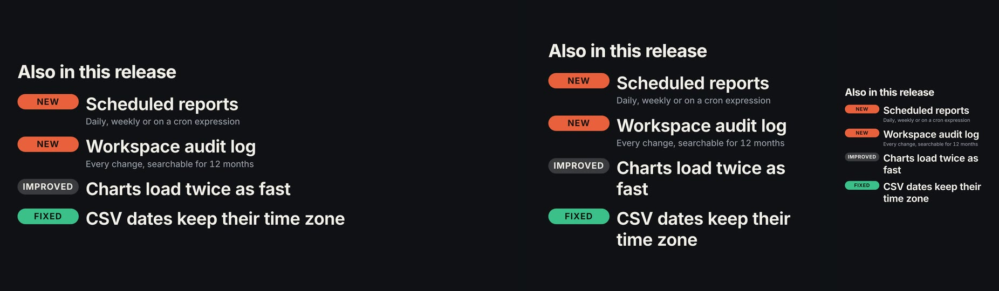

# Reelwright

Reelwright is a Claude plugin that makes short videos from code: release videos, explainers and animated
metrics. A film is one JSON file. A headless browser draws every frame as a function of time, ffmpeg encodes
it, and a quality gate measures the result before you see it.

It loads in Claude Code, in Cowork and in chat on claude.ai. Rendering needs Node 24, ffmpeg and a Chromium-family
browser wherever the session runs; `reel doctor` reports what is missing.

## What it makes

| Release video | Metrics video | Explainer |
|---|---|---|
|  |  |  |
| A changelog becomes a 20 to 40 second clip: the headline change, the proof, what else is new, where to get it. | Numbers become a short data story: headline figures, the chart behind them, what happens next. | One idea, taught in under 90 seconds: the question, one step per scene, the takeaway. |

One spec renders at every aspect ratio. Scenes re-lay themselves out; nothing is cropped.



## Ask for a video

| You say | Skill |
|---|---|
| "Make a release video for 2.4 from CHANGELOG.md" | `/reelwright:release-video` |
| "Turn q3.csv into a 30-second metrics video" | `/reelwright:metrics-video` |
| "Explain how our sync engine resolves conflicts, for new engineers" | `/reelwright:explainer-video` |
| "Make a 15-second square clip announcing the beta" | `/reelwright:video` |
| "Check this film before we post it" | `/reelwright:check-film` |
| "Add a timeline scene type" | `/reelwright:add-scene` |

## How it works

1. **Facts.** Claude pulls names and numbers from your source into `content.json`, each with where it came from.
2. **Storyboard.** One row per scene: the exact words on screen and the seconds they stay there.
3. **Spec and stills.** The storyboard becomes `film.json`. Full-size stills show the layout in seconds.
4. **Render.** Each scene is drawn frame by frame and encoded. A scene that did not change is reused.
5. **Measure.** The quality gate checks the film. A failure names the scene and the number to change.
6. **Deliver.** Export for the platform, with a poster frame.

## The quality gate

A model that looks at still frames will pass a frozen film. So `reel qa` measures instead.

| Gate | What it catches |
|---|---|
| Determinism | A frame that changes with the order frames are drawn in: clocks, randomness, leftover state |
| Layout | Text outside the safe area, clipped, overlapping, too small, or too low in contrast |
| Holds | Text that is not still long enough to read: 0.3 seconds per word plus half a second |
| Pacing | Scenes too short or too long, an empty first or last frame |
| File | Wrong size, frame rate, frame count or codec; a render older than the spec |
| Motion | Frozen stretches, scenes that never move, flashes, a loop that does not close |
| Audio | Loudness outside -16 to -12 LUFS, a true peak above -1 dBTP |

It cannot watch or listen. Press play once before you publish.

## Agents and the model each one uses

Rendering, measuring and encoding are scripts and cost no tokens. The agents put each remaining job on the
smallest model that does it well.

| Agent | Model | Job |
|---|---|---|
| `reel-ingest` | Haiku | Extract facts from changelogs, data files and documents |
| `reel-runner` | Haiku | Run renders, checks and exports; report the numbers |
| `reel-builder` | Sonnet | Write the spec, fix what the gate reports, add 2D scenes |
| `reel-director` | Opus | Decide the message, the structure and the exact words |
| `reel-reviewer` | Opus | Review the film without having built it |
| `reel-auteur` | Fable | One bespoke 3D, physics or illustration-level scene |

Agents load in Claude Code and Cowork. In chat, the skills do the same work in one conversation.

## Install

```bash
claude plugin marketplace add <owner>/<repo>
claude plugin install reelwright@reelwright
```

To try it from a checkout without installing: `claude --plugin-dir ./plugin`.

## Run the engine by hand

You normally ask Claude and it runs these for you. To run them yourself from a checkout of the repository, point
`REEL` at the CLI and work in a folder of your own:

```bash
REEL="$PWD/plugin/skills/video/scripts/reel.ts"
node "$REEL" doctor
mkdir -p ~/films && cd ~/films
node "$REEL" init my-film --template release
cd my-film
node "$REEL" preview film.json
node "$REEL" stills film.json
node "$REEL" render film.json
node "$REEL" qa film.json
node "$REEL" export film.json --preset x --poster auto
```

| Command | What it does |
|---|---|
| `doctor` | Checks Node, ffmpeg, the browser and the bundled fonts |
| `init` | Creates a project from a template: `release`, `metrics`, `explainer`, `blank` |
| `scenes` | Lists the twelve scene types and their fields; `--json` and `--md` for other formats |
| `preview` | Serves the film with a scrubbing player |
| `stills` | Draws full-size stills and a contact sheet; `--every` draws a motion strip |
| `render` | Renders the MP4, scene by scene; `--draft` is a fast preview at half size |
| `qa` | Runs the quality gate; `--page-only` skips the video gates, `--size WxH` checks another format |
| `export` | Writes delivery files: `master`, `x`, `linkedin`, `youtube`, `slack`, `web`, `gif`, `webm` |
| `build` | Bundles the film into one HTML file that plays in a browser |

## Requirements

Node 24 or newer, ffmpeg with ffprobe, and Chrome, Chromium or Edge. Nothing else is installed: the plugin has
no package dependencies and no build step. The source is TypeScript that Node runs directly.

## What it runs and what it sends

Reelwright sends no data anywhere. It has no telemetry, makes no network requests, and reads no credentials.

While a command runs it starts three local processes: a headless browser to draw frames, ffmpeg and ffprobe to
encode and measure, and a file server bound to 127.0.0.1 that serves the film page and your project folder to
that browser. The server answers only requests addressed to 127.0.0.1 or localhost, and does not serve hidden
files or links that lead out of the project. All three stop when the command ends or is interrupted. Output is
written to the `out/` folder of your project.

Inter and JetBrains Mono are bundled under the SIL Open Font License, so Latin and Cyrillic text looks the same
on every machine. Other scripts are drawn with a font from the machine.

## Limits

- Code-drawn video suits type, data, diagrams, code and screenshots. It is not for footage or photoreal scenes.
- Sound is added at export from a file you supply. There is no built-in music or voice.
- A bespoke scene is written per project. The twelve built-in scene types cover the common cases.

## Licence

MIT. Bundled fonts: SIL Open Font License 1.1.
