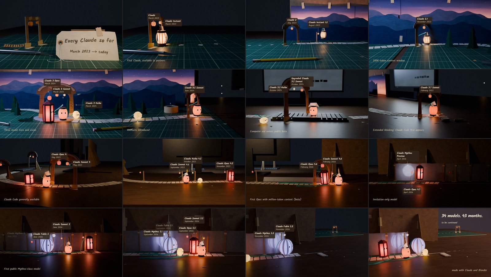
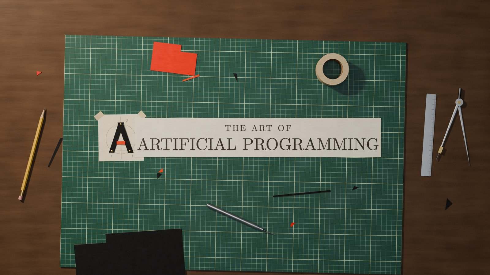
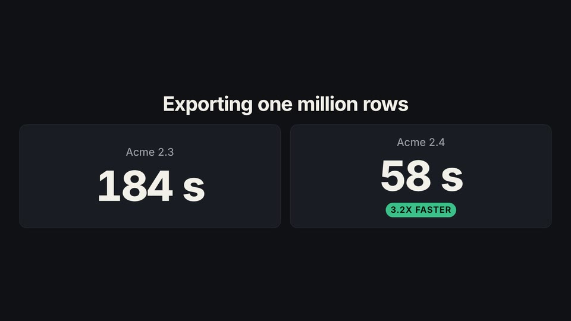
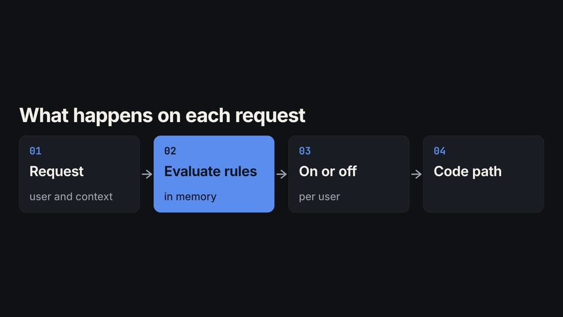

# Reelwright

Reelwright is a Claude plugin for making films. Ask for a film about something, and Claude finds the facts,
writes a story and six different ways it could look, builds one real shot for you to judge, then animates and
renders the rest in Blender, lays the words and sound over it, measures it, and has it reviewed by an agent that
did not make it. Each film gets a look of its own, steered by what you have told it you like.

For videos that recur (the release notes every month, the quarterly numbers) it keeps a library of code-drawn
scenes that turns a JSON file into a checked clip in minutes.

It loads in Claude Code, in Cowork and in chat on claude.ai.

<!-- IMAGE PLACE 1: docs/img/film-still.jpg, a full-size frame from the first film made with 0.2.0.
     When the file exists, replace this comment with:
      -->

## Two ways to make a video

| A film | A scene video |
|---|---|
| A premise, original characters and a made world: stop-motion paper on a desk, a painted valley, a glass city at night, whatever fits the subject. Rendered in Blender, shot by shot. | A release, a metric or an idea laid out in thirteen prebuilt scene types that adapt to every aspect ratio. Drawn in a headless browser. |
| Hours of rendering; one sample shot shown to you first. | Seconds for stills, minutes for the render. |
| `/reelwright:film` | `/reelwright:video` and the recipes below |

## Make a film

**What you need.** Blender 5.x, open, with a Blender MCP server connected to your Claude session. Nothing else to
buy or connect: no image or video generation service, no other app. The engine that assembles and measures the
film needs Node 24, a Chromium-family browser and ffmpeg wherever the session's shell runs. In a cloud session
they are there or the session installs them; on your own computer `reel doctor` says what is missing.

**What runs where.** Both layouts work and the film skill finds out which one it is in at the first call.

| | One machine | Workspace plus your Blender machine |
|---|---|---|
| Claude, the engine, the files | your computer | a cloud workspace |
| Blender and its renders | your computer, same disk | your computer, reached through the bridge |
| How files move | they do not need to | the bridge's stage and commit tools, one file or one packed plate at a time |

**How a film is made.**

1. **Facts first.** Every name, number and date on screen is checked against its source before any picture.
2. **Pitches.** Six or more ways the film could look, different in medium, not only in colour. One is chosen by
   fit with the story and the audience, and the treatment says why. It must differ from your recent films unless
   you ask for a series. Your own words override all of it.
3. **One real sample.** One shot built and rendered at final quality, with its words and sound, before anything
   else. You say yes or what is wrong. This is the only time the pipeline waits for you.
4. **A shot plan.** Every shot with its poses, camera, the exact words of every label and every sound cue,
   validated by `reel plan` before a frame is rendered.
5. **Animation by sequence.** One animator agent per sequence of three or four shots, each reading what the last
   one built and measured, each checking three poses at final quality before queueing the full render.
6. **Assembly and measurement.** `reel assemble` writes the film from the plan and the plates; the quality gate
   and the cut report measure it.
7. **A critic that did not make it.** Facts against the dataset, a check for the marks of a generic render, every
   finding classed as a spec fix, a re-render of named poses, or leave. One fix pass.
8. **Hand-over.** The film, the treatment, and a plain list of what nobody saw or heard: agents see stills and
   numbers, so you watch it once with sound before it goes anywhere.

**What it costs.** The first film, 93 seconds of stop-motion in 16 shots, took about 3 million tokens and about
five hours of rendering on a laptop GPU (10 to 24 seconds a frame at 1080p, 12 frames a second of film). The
treatment carries a budget for every film, and you can cap it.

**Your taste, remembered.** Two files in your films folder steer every film: `studio/PROFILE.md` records who the
films are for, your voice, and what you accepted and rejected, in your own words and dated; `studio/ledger.json`
records the look of every finished film so the next one does not repeat it. Claude offers to add to them when
you approve or correct a look, and never writes down a taste you did not express.

**Publishing.** The publish skill prepares a kit beside the film: title options, a description with chapters,
tags, a thumbnail, every upload setting with a reasoned answer to the AI-content question, what a vertical or
square version would need, and channel art (banner, profile picture, watermark) rendered in the film's own look.
It prepares; you upload. Platform numbers in it are dated and checked again before use.

<!-- IMAGE PLACE 2: docs/img/channel-art.jpg, the channel banner, profile picture and watermark made for that
     film, side by side. When the file exists, replace this comment with:
      -->

## Make a scene video

| Release video | Metrics video | Explainer |
|---|---|---|
|  |  |  |
| A changelog becomes a 20 to 40 second clip: the headline change, the proof, what else is new, where to get it. | Numbers become a short data story: headline figures, the chart behind them, what happens next. | One idea, taught in under 90 seconds: the question, one step per scene, the takeaway. |

One spec renders at every aspect ratio. Scenes re-lay themselves out; nothing is cropped.


1. **Facts.** Claude pulls names and numbers from your source into `content.json`, each with where it came from.
2. **Storyboard.** One row per scene: the exact words on screen and the seconds they stay there.
3. **Spec and stills.** The storyboard becomes `film.json`. Full-size stills show the layout in seconds.
4. **Render.** Each scene is drawn frame by frame and encoded. A scene that did not change is reused.
5. **Measure.** The quality gate checks the film. A failure names the scene and the number to change.
6. **Deliver.** Export for the platform, with a poster frame.

## Ask for it

| You say | Skill |
|---|---|
| "Make a film about our release history" | `/reelwright:film` |
| "Turn these release notes into a short film that looks hand-made" | `/reelwright:film` |
| "Remember that I like real materials and don't want taglines" | `/reelwright:studio` |
| "Prepare this video for YouTube" or "Make a channel banner in the film's look" | `/reelwright:publish` |
| "Make a release video for 2.4 from CHANGELOG.md" | `/reelwright:release-video` |
| "Turn q3.csv into a 30-second metrics video" | `/reelwright:metrics-video` |
| "Explain how our sync engine resolves conflicts, for new engineers" | `/reelwright:explainer-video` |
| "Make a 15-second square clip announcing the beta" | `/reelwright:video` |
| "Check this film before we post it" | `/reelwright:check-film` |
| "Add a timeline scene type" | `/reelwright:add-scene` |

## The quality gate

A model that looks at still frames will pass a frozen film. So `reel qa` measures instead.

| Gate | What it catches |
|---|---|
| Determinism | A frame that changes with the order frames are drawn in: clocks, randomness, leftover state |
| Layout | Text outside the safe area, clipped, overlapping, too small, or too low in contrast |
| Holds | Text that is not still long enough to read: 0.3 seconds per word plus half a second |
| Pacing | Scenes too short or too long, an empty first or last frame |
| File | Wrong size, frame rate, frame count or codec; a render older than the spec |
| Motion | Frozen stretches, scenes that never move, flashes, a loop that does not close |
| Audio | Loudness outside -16 to -12 LUFS, a true peak above -1 dBTP |
| Cuts | A jump in brightness or loudness at a cut between two shots (a warning, for a person to judge) |

Before assembly, `reel plate` also checks every Blender plate for frames whose brightness jumps out of line with
their neighbours. None of this can watch or listen. Press play once, with sound, before you publish.

## Agents and the model each one uses

Rendering, measuring and encoding are scripts and cost no tokens. The agents put each remaining job on the
smallest model that does it well.

| Agent | Model | Job |
|---|---|---|
| `reel-ingest` | Haiku | Extract facts from changelogs, data files and documents |
| `reel-runner` | Haiku | Run renders, checks and exports; report the numbers |
| `reel-builder` | Sonnet | Assemble a film from its plan and plates, or write a scene spec; fix what the gate reports |
| `reel-director` | Opus | Pitches, the treatment and the shot plan; or the storyboard of a scene video |
| `reel-animator` | Opus | Build, animate and render one sequence of a film in Blender |
| `reel-critic` | Opus | Review a finished film it did not make: facts, generic-render marks, classed findings |
| `reel-reviewer` | Opus | Review a scene video without having built it |
| `reel-auteur` | Fable | One bespoke 3D, physics or illustration-level scene in a scene video |

Agents load in Claude Code and Cowork. In chat, the skills do the same work in one conversation.

## Install

```bash
claude plugin marketplace add <owner>/<repo>
claude plugin install reelwright@reelwright
```

To try it from a checkout without installing: `claude --plugin-dir ./plugin`.

## Run the engine by hand

You normally ask Claude and it runs these for you. To run them yourself from a checkout of the repository, point
`REEL` at the CLI and work in a folder of your own:

```bash
REEL="$PWD/plugin/skills/video/scripts/reel.ts"
node "$REEL" doctor
mkdir -p ~/films && cd ~/films
node "$REEL" init my-film --template release
cd my-film
node "$REEL" preview film.json
node "$REEL" stills film.json
node "$REEL" render film.json
node "$REEL" qa film.json
node "$REEL" export film.json --preset x --poster auto
```

| Command | What it does |
|---|---|
| `doctor` | Checks Node, ffmpeg, the browser and the bundled fonts |
| `init` | Creates a project from a template: `release`, `metrics`, `explainer`, `blank` |
| `scenes` | Lists the thirteen scene types and their fields; `--json` and `--md` for other formats |
| `preview` | Serves the film with a scrubbing player |
| `stills` | Draws full-size stills and a contact sheet; `--every` draws a motion strip |
| `render` | Renders the MP4, scene by scene; `--draft` is a fast preview at half size; adds generated sound when `meta.sound` is on, `--no-sound` skips it |
| `sound` | Generates the film's background sound (`meta.sound`) as `out/sound.wav` and a cue list; prints length, cues and loudness |
| `qa` | Runs the quality gate; `--page-only` skips the video gates, `--size WxH` checks another format |
| `export` | Writes delivery files: `master`, `x`, `linkedin`, `youtube`, `slack`, `web`, `gif`, `webm` |
| `plate` | Checks a plate folder (an image sequence with `tracks.json`): tracks, events, every frame file, the frame size, and frames whose brightness jumps out of line with their neighbours |
| `plan` | Validates a film's shot plan: schema, totals, reading time of every label, label budget per second, cue kinds, missing plates |
| `assemble` | Writes the film spec from the shot plan, the plates and the side files beside the plan; `--shots`, `--format`, `--intro`, `--outro` |
| `cuts` | After a render, reports the brightness and loudness change at every cut and flags the large ones |
| `chapters` | Prints video chapters from the scene starts: first at 0:00, each at least 10 seconds |
| `build` | Bundles the film into one HTML file that plays in a browser |

## Requirements

Node 24 or newer, ffmpeg with ffprobe, and Chrome, Chromium or Edge. Nothing else is installed: the plugin has
no package dependencies and no build step. The source is TypeScript that Node runs directly.

A film made in Blender also needs Blender 5.x with a Blender MCP server connected to the session. The plugin's
Blender library (`skills/video/blender/reel_blender/`) is plain Python that runs inside Blender; the lettering and
measuring helpers also use Pillow and numpy where the session's shell runs.

## What it runs and what it sends

Reelwright sends no data anywhere. It has no telemetry, makes no network requests, and reads no credentials.
For a Blender film, Claude sends Python to your Blender through the MCP server you connected, and in the
two-machine layout files move between the workspace and your computer through the bridge you connected. Nothing
goes to any other service: there is no image, video or voice generation.

While a command runs it starts three local processes: a headless browser to draw frames, ffmpeg and ffprobe to
encode and measure, and a file server bound to 127.0.0.1 that serves the film page and your project folder to
that browser. The server answers only requests addressed to 127.0.0.1 or localhost, and does not serve hidden
files or links that lead out of the project. All three stop when the command ends or is interrupted. Output is
written to the `out/` folder of your project, named after the spec (`film.json` gives `out/film.mp4`, `film-desk.json` gives `out/film-desk.mp4`).

Inter and JetBrains Mono are bundled under the SIL Open Font License, so Latin and Cyrillic text looks the same
on every machine. Other scripts are drawn with a font from the machine.

## Limits

- Code-drawn scene video suits type, data, diagrams, code and screenshots. Anything with a made world, light and
  materials is a Blender film.
- A Blender film takes hours of rendering and a few million tokens. A film is reviewed from stills and
  measurements; nobody in the pipeline watches it at speed or listens to it, and the hand-over says so.
- Sound is generated sound design (a quiet bed and cues timed to the picture, six palettes), not composed music, and there is no voice. For a score of your own, add it at export with `--audio`.
- A bespoke scene is written per project. The thirteen built-in scene types cover the common cases.

## Licence

MIT. Bundled fonts: SIL Open Font License 1.1.
